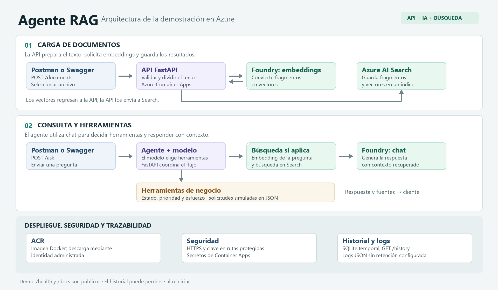
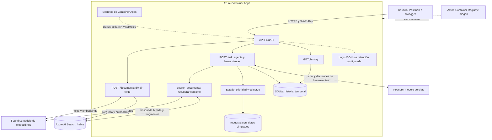

# Arquitectura

El siguiente diagrama Mermaid ofrece una vista adicional de los componentes:

## Flujo de `/ask`
1. Se valida la entrada (longitud, `session_id`) y la API key.
2. El agente envía la pregunta al modelo con las definiciones de tools (function calling).
3. Si el modelo pide `search_documents`, se genera el embedding de la consulta y se hace búsqueda híbrida (texto + vector) en Azure AI Search; los fragmentos vuelven al modelo como **datos no confiables**.
4. El modelo puede encadenar otras tools (máx. 5 pasos). Los argumentos se validan en código antes de ejecutarse.
5. Se responde con la respuesta, fuentes, tools usadas y latencia, y se guarda la interacción.

## Flujo de `/documents`
Validación (extensión, tamaño, UTF-8, nombre saneado) → chunking por párrafos (800 caracteres, solape 120) → embeddings → reemplazo de los chunks previos del mismo documento → indexado.

## Alcance del despliegue
Foundry y Search utilizan claves guardadas como secretos de Container Apps; la identidad administrada se usa para obtener la imagen de ACR. `/health` y `/docs` no requieren API key. El historial SQLite es efímero y los logs de contenedor no tienen almacenamiento configurado. Application Insights, autorización por usuario y persistencia administrada son mejoras propuestas, no servicios ya configurados.
